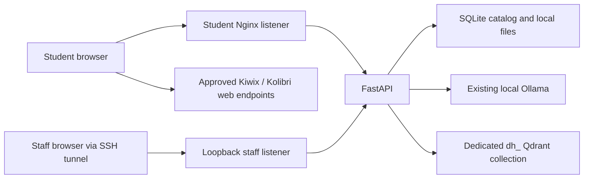

# Architecture

Students open a static portal and call `/api` on that same origin.
Only the API talks to the local model and vector database.
Staff use a different reverse-proxy listener through a local or SSH-forwarded connection.

The [network design](NETWORK.md) defines proposed zones and allowed traffic.
No model, database or NOMAD management port is published by this Compose project.

## Ownership and persistence

`frontend/` owns UI, localization, navigation and transient conversation memory.
`backend/app/` owns validation, service HTTP contracts, catalog state, ingestion and source assembly.
`deployment/` owns the two Nginx listeners.
The `content-data` volume contains the catalog and uploaded files; Qdrant persistence is owned by the existing service deployment.
Back up both together.

Document IDs hash file bytes and metadata.
Chunk IDs are stable UUIDs derived from document ID, page and offset.
Retries upsert the same vector points and return an existing ready document for the same import.
Imports remain invisible to students until all batches and the local file are saved.
Failed vector batches can leave unused points; the catalog readiness check excludes them from retrieval.
An interrupted process may leave `indexing` entries; reimporting the identical file retries them.
Recovery tooling and garbage collection are follow-up work.

## Service contracts

| Method | Route | Behavior |
| --- | --- | --- |
| GET | `/api/health` | Application liveness; not a claim of model readiness |
| GET | `/api/services` | Probed model/vector reachability and configured resource destinations |
| GET | `/api/textbooks` | Ready documents filtered by optional grade/subject |
| GET | `/api/textbooks/{id}` | Safe document metadata |
| GET | `/api/textbooks/{id}/file` | Catalog-resolved PDF or text; no raw path input |
| POST | `/api/tutor/chat` | Local embeddings, filtered retrieval, local model answer and source metadata |
| GET | `/api/admin/index-status` | Authenticated service checks and all import states |
| POST | `/api/admin/documents` | Authenticated bounded PDF/text import |

Ollama receives `/api/embed` and `/api/chat` requests with no client-side credentials.
Qdrant receives collection management, stable point upserts and filtered `/points/query` requests.
Embedding dimensions come from returned vectors, and existing collection dimensions are checked before writing.
Student answers have `grounding: textbook` when passages were retrieved or `general` when no suitable passages were retrieved.
Failures use HTTP 503; no canned answer is substituted.

The model receives grade/language instructions, bounded history, and retrieved data marked as untrusted.
Prompt wording reduces injection risk but does not guarantee immunity.
The model has no tools, filesystem access, or execution capability through this application.
Answers render as text, not HTML.

## Verified upstream interfaces

- [Ollama chat API](https://docs.ollama.com/api/chat) and [embedding API](https://docs.ollama.com/api/embed).
- [Qdrant query API](https://api.qdrant.tech/api-reference/search/query-points) and [collection semantics](https://qdrant.tech/documentation/manage-data/collections/).
- [EmbeddingGemma prompt instructions](https://huggingface.co/google/embeddinggemma-300m#prompt-instructions) for query/document formatting.
- [NOMAD capabilities and security notes](https://github.com/Crosstalk-Solutions/project-nomad#about-security).

Keep configured endpoints local and verify the installed upstream versions before deploying.
The portal does not depend on undocumented NOMAD control routes.
