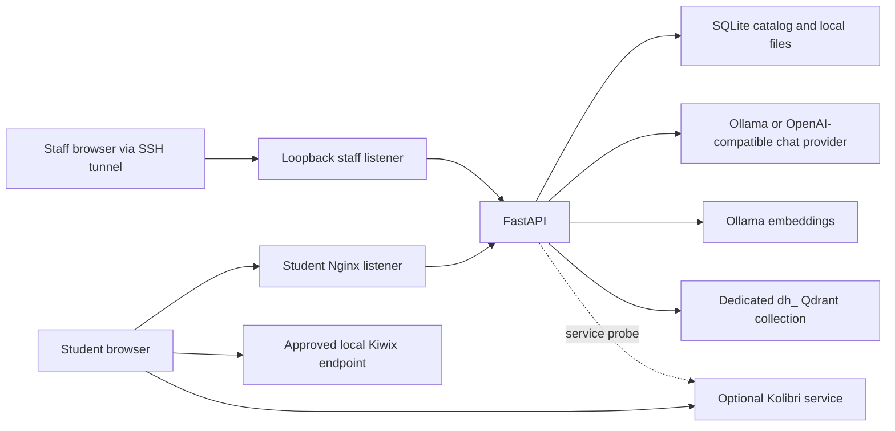

# Architecture

Students open a static portal and call `/api` on that same origin.
Only the API talks to chat, embedding, and vector services.
Chat can use local Ollama or a configurable OpenAI-compatible endpoint.
Textbook embeddings remain in Ollama, and retrieval remains in the dedicated Qdrant collection.
Staff use a different reverse-proxy listener through a local or SSH-forwarded connection.

The [network design](NETWORK.md) defines proposed zones and allowed traffic.
No model, database or NOMAD management port is published by this Compose project.

## Project NOMAD status

This repository is not currently integrated as a NOMAD-managed add-on or installer workflow.
It does not call NOMAD management APIs or discover NOMAD services automatically.
An operator can run this application alongside an existing Project NOMAD installation by manually configuring the service URLs in `.env` after verifying their addresses and versions.
The application keeps its own Docker Compose project and does not install or modify NOMAD-managed services.
Any supported add-on integration should use documented extension points and service interfaces, then be tested against a pinned NOMAD release.

## Ownership and persistence

`frontend/` owns UI, localization, navigation and transient conversation memory.
`backend/app/` owns validation, service HTTP contracts, catalog state, ingestion and source assembly.
`deployment/` owns the two Nginx listeners.
The `content-data` volume contains the catalog and uploaded files; Qdrant persistence is owned by the existing service deployment.
When the optional `education` Compose profile is enabled, Kolibri uses its own `kolibri-data` volume and student-facing ports 8092/8093 by default.
The portal links to Kolibri and the API checks its configured health URL; Kolibri handles its own learners, coaches, classes, progress and course content.
There is no shared login, account synchronization, automatic course import, or direct tutor-to-Kolibri content ingestion.
Back up the catalog and vector index together.

Document IDs hash file bytes and metadata.
Chunk IDs are stable UUIDs derived from document ID, page and offset.
Retries upsert the same vector points and return an existing ready document for the same import.
Imports remain invisible to students until all batches and the local file are saved.
Failed vector batches can leave unused points; the catalog readiness check excludes them from retrieval.
An interrupted process may leave `indexing` entries; reimporting the identical file retries them.
Recovery tooling and garbage collection are follow-up work.

## Service contracts

| Method | Route | Behavior |
| --- | --- | --- |
| GET | `/api/health` | Application liveness; not a claim of model readiness |
| GET | `/api/services` | Local model/vector reachability and chat-provider configuration state |
| GET | `/api/textbooks` | Ready documents filtered by optional grade/subject |
| GET | `/api/textbooks/{id}` | Safe document metadata |
| GET | `/api/textbooks/{id}/file` | Catalog-resolved PDF or text; no raw path input |
| POST | `/api/tutor/chat` | Optional local embeddings, filtered retrieval, configured chat answer and source metadata |
| GET | `/api/admin/index-status` | Authenticated service checks and all import states |
| POST | `/api/admin/documents` | Authenticated bounded PDF/text import |

Ollama receives `/api/embed` requests and, in local-chat mode, `/api/chat` requests.
OpenAI-compatible mode uses the configured `CHAT_API_BASE_URL`, `CHAT_API_KEY`, and `CHAT_MODEL` through the OpenAI Python SDK.
The default provider URL is Baseten's OpenAI-compatible endpoint, and the default model is `meta-models/muse-spark-open-1026`.
External provider status is reported as configured without sending health-check requests.
Qdrant receives collection management, stable point upserts and filtered `/points/query` requests.
Embedding dimensions come from returned vectors, and existing collection dimensions are checked before writing.
Student answers have `grounding: textbook` when passages were retrieved or `general` when no suitable passages were retrieved.
Failures use HTTP 503; no canned answer is substituted.

The selected chat provider receives grade/language instructions, bounded history, and retrieved data marked as untrusted.
When a hosted provider is selected, those prompts and passages leave the school network.
Prompt wording reduces injection risk but does not guarantee immunity.
The model has no tools, filesystem access, or execution capability through this application.
Answers render as text, not HTML.

## Verified upstream interfaces

- [Ollama chat API](https://docs.ollama.com/api/chat) and [embedding API](https://docs.ollama.com/api/embed).
- [Qdrant query API](https://api.qdrant.tech/api-reference/search/query-points) and [collection semantics](https://qdrant.tech/documentation/manage-data/collections/).
- [EmbeddingGemma prompt instructions](https://huggingface.co/google/embeddinggemma-300m#prompt-instructions) for query/document formatting.
- [Kolibri official container instructions](https://github.com/learningequality/kolibri/blob/develop/docker/README.md) and [offline content-import guidance](https://kolibri.readthedocs.io/en/latest/manage/resources.html).
- [NOMAD capabilities and security notes](https://github.com/Crosstalk-Solutions/project-nomad#about-security).

Keep Ollama and Qdrant on a restricted service network, and allow outbound HTTPS from the API only when a hosted chat provider is selected.
Verify installed upstream versions before deploying.
The portal does not depend on undocumented NOMAD control routes.
