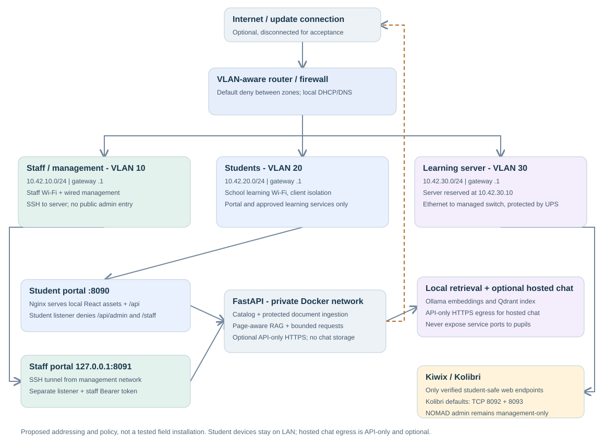

# Proposed school network

Use separate student, staff and server networks with a default-deny firewall between them.
This is a proposed design with example addresses, not evidence of a configured or simulated school network.
Confirm the router/AP feature set and existing addressing before applying it.



Open [the editable draw.io file](network/school-network.drawio) in diagrams.net or a compatible offline editor.
The SVG is a portable review copy.
No Cisco Packet Tracer simulation is claimed.

## Addressing and equipment

| Zone | VLAN | Example subnet | Addressing |
| --- | --- | --- | --- |
| Staff/management | 10 | `10.42.10.0/24` | Gateway `.1`, AP management reserved `.2`, staff DHCP `.100-.199` |
| Student learning | 20 | `10.42.20.0/24` | Gateway `.1`, student DHCP `.50-.199` |
| Learning services | 30 | `10.42.30.0/24` | Gateway `.1`, server DHCP reservation/static `.10` |

The preferred design needs a VLAN-aware router/firewall, managed switch, and an AP that maps separate SSIDs to VLANs.
Connect the server by Ethernet to a VLAN 30 access port.
Use a tagged uplink to the AP and switch, keep management on VLAN 10, and enable student client isolation where supported.
Protect the router, switch/AP power supply and server with an appropriately sized UPS; solar sizing requires measured site loads.
Do not assume UPS equipment can power a classroom all day.

DHCP and any local DNS must work without WAN.
Use `http://10.42.30.10:8090` first; configure an appropriate school-controlled DNS name later if supported.
The optional Kolibri service uses `http://10.42.30.10:8092` and its packaged-content port `8093` by default when `KOLIBRI_BIND` is set to the server address.
Do not rely on public DNS or cross-VLAN multicast hostname discovery.
Keep router/AP time locally available where supported and record clock behavior after power loss.

## Firewall policy

Apply established/related return rules, then the narrow permits below, then deny the rest.
Mirror the policy for IPv6 or disable routed IPv6 until equivalent controls are tested.
Do not expose router administration, SSH, Docker, NOMAD, Ollama or Qdrant through the student SSID.

| Source | Destination | Permit | Purpose |
| --- | --- | --- | --- |
| Student clients | Student gateway | DHCP and local DNS; local NTP if configured | Basic offline network service |
| Student clients | `10.42.30.10` | TCP 8090 | Student portal and public application API |
| Student clients | Verified local content hosts | Kiwix web port; Kolibri host ports 8092 and 8093 by default | Approved reference, course, lesson, and packaged-content access |
| Staff management | Kolibri service host | Kolibri host ports 8092 and 8093 by default | Coach/admin access using Kolibri accounts |
| Staff management | Router/AP management | Required management protocol only | Authorized network operation |
| Staff management | Learning server | TCP 22 | SSH and staff portal tunneling |
| Portal container | API container | TCP 8000 on private Docker network | Same-origin app requests |
| API process/container | Verified model/vector hosts | Only configured Ollama/Qdrant service ports | Embeddings, inference and retrieval |
| API process/container | Configured OpenAI-compatible chat provider | DNS plus outbound TCP 443 only when hosted chat is enabled | Optional hosted inference; learner prompts and retrieved excerpts leave the school network |
| Trusted operator, during provisioning | Approved update destinations | Explicit temporary WAN access | Package, image, model and content downloads |

Do not copy hypothetical content ports into rules.
If host ports are changed, update the firewall rule to match the Compose mapping.
The public/probe URL distinction exists because the container may use a different network path from a phone.
A green server-side probe is not a student-path test.
Disable WAN forwarding for the offline acceptance session.
When a hosted chat provider is selected, AI chat will be unavailable without WAN access; the local library remains available.
Student devices never connect directly to the hosted provider.
Block student-to-student traffic and all other inter-zone access, including direct access to server management services.
Check Docker-published ports on the host as well as router ACLs; a host firewall alone may not control every Docker forwarding path.

## Staff entry

Compose publishes the staff listener only on the Ubuntu host's loopback address, port 8091.
On an authorized staff laptop in VLAN 10, use a local SSH forward:

```sh
ssh -N -L 8091:127.0.0.1:8091 STAFF_SSH_USER@10.42.30.10
```

Replace `STAFF_SSH_USER` with a verified local account, then open `http://127.0.0.1:8091/staff` on that laptop.
The tunnel protects traffic in transit; the API separately requires the staff token.
The student listener denies the staff path/API independently of the token.
NOMAD administration requires its own protected management path and must not be linked from the portal.

## If the available router cannot isolate VLANs

Use a separate management interface/network with no forwarding from the student network, or restrict the first demonstration to the teacher's local console.
Do not claim a flat shared Wi-Fi network meets the management-isolation gate merely because staff links are hidden.
The reverse proxy protects this application, not unrelated services already bound to the server's LAN interfaces.

## Commissioning checks

1. Verify DHCP reservation, gateway, DNS and portal access from a phone with cellular disabled.
2. From the student SSID, verify portal access and one real article/video, then verify router/AP management, SSH, NOMAD, model/vector ports and staff entry are unreachable.
3. From the management network, verify SSH forwarding and authenticated import work.
4. Disconnect WAN, restart router/AP and server, and repeat the permitted and denied tests.
5. Test 12 library clients separately from AI load, recording latency, packet loss, Wi-Fi coverage, server temperature, power use and recovery behavior.

Keep device inventories, real addresses, credentials and school-specific configuration backups in private storage.
